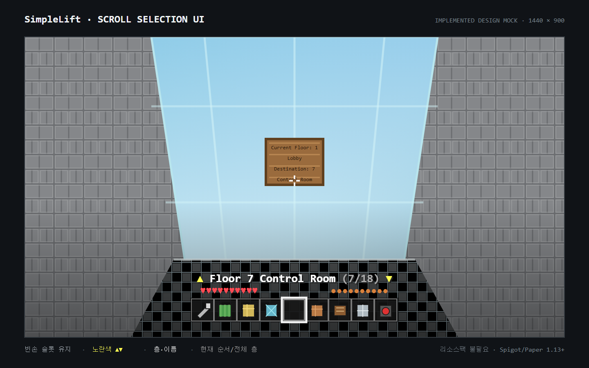

# SimpleLift

**SimpleLift by PLAYCITY BLOCK**

[English](README.md)

SimpleLift는 기존 Lift와 LiftReloaded 구조를 그대로 사용하는 경량 승강기 플러그인입니다. 블록, 버튼, 표지판에서 층을 판별하므로 기존 승강기를 데이터베이스로 변환할 필요가 없습니다.

## 호환성

- Minecraft 1.13부터 26.2까지
- Bukkit, Spigot, Paper, Purpur 계열 서버
- 모든 지원 버전에 사용하는 단일 Java 8 바이트코드 JAR
- Paper 1.13.2, 1.16.5, 1.20.6, 1.21.8, 26.2 런타임 검증
- Folia는 리전 스케줄링이 구현되지 않아 감지 후 비활성화

모든 중간 버전을 실행한 것은 아닙니다. 검증한 버전과 제한 사항은 [호환성 보고서](docs/compatibility.ko.md)를 확인하십시오.

## 설치 또는 기존 Lift 교체

1. 서버를 종료하고 월드와 `plugins` 폴더를 백업합니다.
2. 기존 Lift 또는 LiftReloaded JAR만 제거합니다.
3. `SimpleLift-0.3.0-SNAPSHOT.jar`를 `plugins`에 넣습니다.
4. 서버를 정상적으로 시작합니다.
5. `/lift info`를 실행하고 기존 승강기를 시험합니다.

`plugins/SimpleLift/config.yml`이 없으면 다음 순서로 설정을 가져옵니다.

1. `plugins/LiftReloaded/config.yml`
2. `plugins/Lift/config.yml`
3. 내장 기본 설정

SimpleLift와 기존 플러그인을 동시에 로드하지 마십시오. 핫 리로드 대신 서버를 완전히 재시작하십시오.

## 승강기 구조

각 층은 같은 승강기 단면을 사용합니다.

```text
바닥 + 3  [벽 표지판: 현재 층과 목적지]
바닥 + 2  [벽 버튼]
바닥 + 1  [빈 공간 또는 선택적 층 이름 벽 표지판]
바닥      [최하층은 baseBlocks, 나머지는 floorBlocks]
```

제어 표지판은 버튼 바로 위에 둡니다. 최하층의 연결된 `baseBlocks`가 승강기 단면을 정합니다.

빈 제어 표지판을 처음 한 번 우클릭하면 모든 층 표지판을 초기화합니다.

## 사용법

- 아이템을 들고 제어 표지판을 우클릭하면 목적지가 순환합니다.
- 빈손으로 표지판을 우클릭한 뒤 3블록 안에서 스크롤하면 층을 선택합니다.
- 웅크린 채 스크롤하면 `selection.fastStep`만큼 이동합니다.
- 손 바꾸기 키, 표지판 재클릭 또는 승강기 버튼으로 선택을 확정합니다.
- 버튼을 누르면 선택한 층으로 이동합니다.
- 같은 승강기 단면 안의 탑승자는 함께 이동합니다.
- 다른 층의 호출은 운행이 끝날 때까지 `busy`로 거절됩니다.
- `redstone: true`이면 버튼이나 버튼 지지 블록의 전원 신호로 호출할 수 있습니다.

액션바에는 선택 층, 층 이름, 현재 층이 표시됩니다. 기본 선택 제한 시간은 8초입니다.



이미지는 실제 게임 캡처가 아닌 디자인 참고 자료입니다.

## 명령어와 권한

| 명령어 또는 권한 | 용도 | 기본값 |
|---|---|---|
| `/lift info` | 플러그인 버전과 지원 범위 표시 | `lift` |
| `/lift reload` | 설정 검증 후 다시 읽기 | OP |
| `lift` | 승강기 탑승과 기본 명령 사용 | 모두 |
| `lift.change` | 표지판 목적지 변경 | 모두 |
| `lift.reload` | 설정 다시 읽기 | OP |

## 설정

주요 설정:

- `baseBlocks`: 최하층 재료와 이동 속도
- `floorBlocks`, `buttonBlocks`, `signBlocks`, `shaftBlocks`: 재료 이름 또는 글로브 패턴
- `maxLiftArea`, `minHeight`, `maxHeight`: 제한된 탐색 범위
- `mouseScroll`, `selection.*`: 층 선택 조작
- `preventEntry`, `preventLeave`, `liftMobs`, `redstone`: 운행 동작
- `soundEnabled`, `soundVolume`: 이동 효과음
- `messages`: 사용자 메시지와 색상 코드

기존 `music: true` 항목은 계속 읽습니다. 현재는 NoteBlockAPI `.nbs` 대신 기본 이동 효과음을 사용합니다.

## 빌드

최저 지원 API 기준 빌드와 테스트:

```powershell
.\gradlew.bat clean build --console=plain
```

JDK 25에서 Paper 26.2 API 교차 컴파일:

```powershell
.\gradlew.bat clean test --console=plain `
  '-PapiGroup=io.papermc.paper' `
  '-PapiArtifact=paper-api' `
  '-PapiVersion=26.2.build.112-stable' `
  '-PjavaToolchainVersion=25' `
  '-PjavaRelease=8'
```

## 제한 사항

- `api-version`이 `1.13`이므로 Minecraft 1.12 이하에서는 로드되지 않습니다.
- Folia는 지원하지 않습니다.
- 프로세스가 강제 종료되면 운행 중 임시 바닥 복구가 중단될 수 있습니다.
- 운영 적용 전 [수동 인수 테스트](docs/manual-acceptance.ko.md)를 완료하십시오.

## 라이선스

SimpleLift는 GNU GPL version 3으로 배포합니다. croxis의 Lift와 kikelkik의 LiftReloaded를 잇는 호환 플러그인입니다. [LICENSE](LICENSE)와 [THIRD_PARTY_NOTICES.md](THIRD_PARTY_NOTICES.md)를 확인하십시오.
